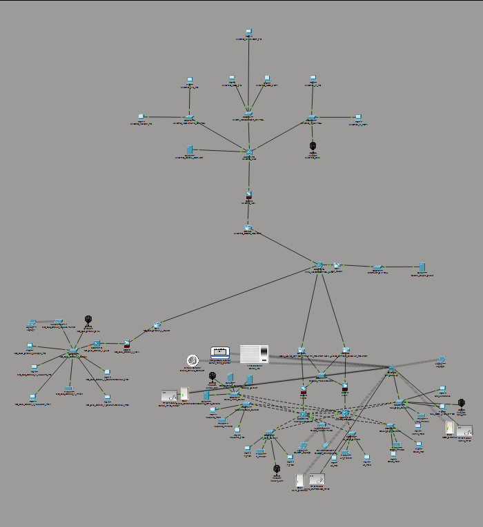
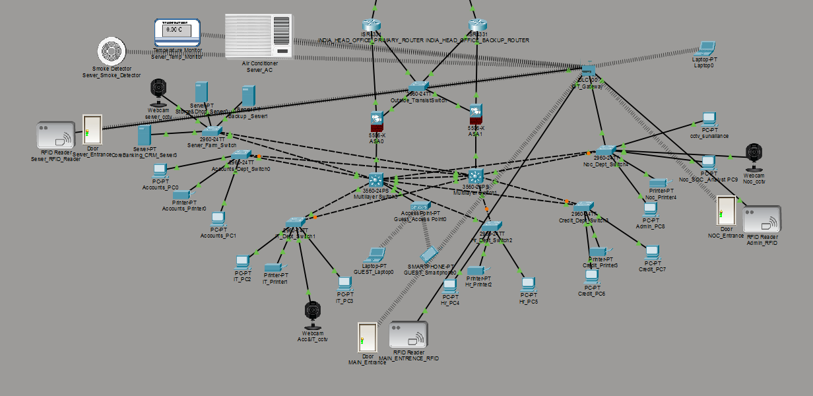
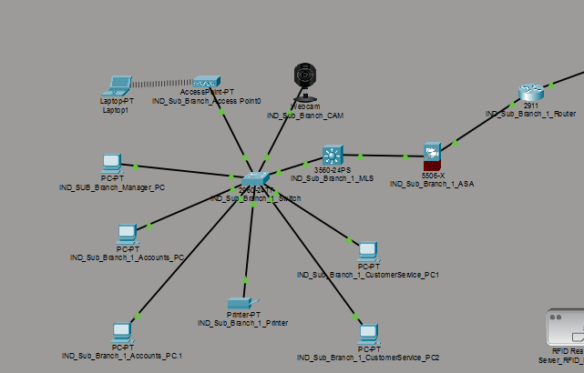
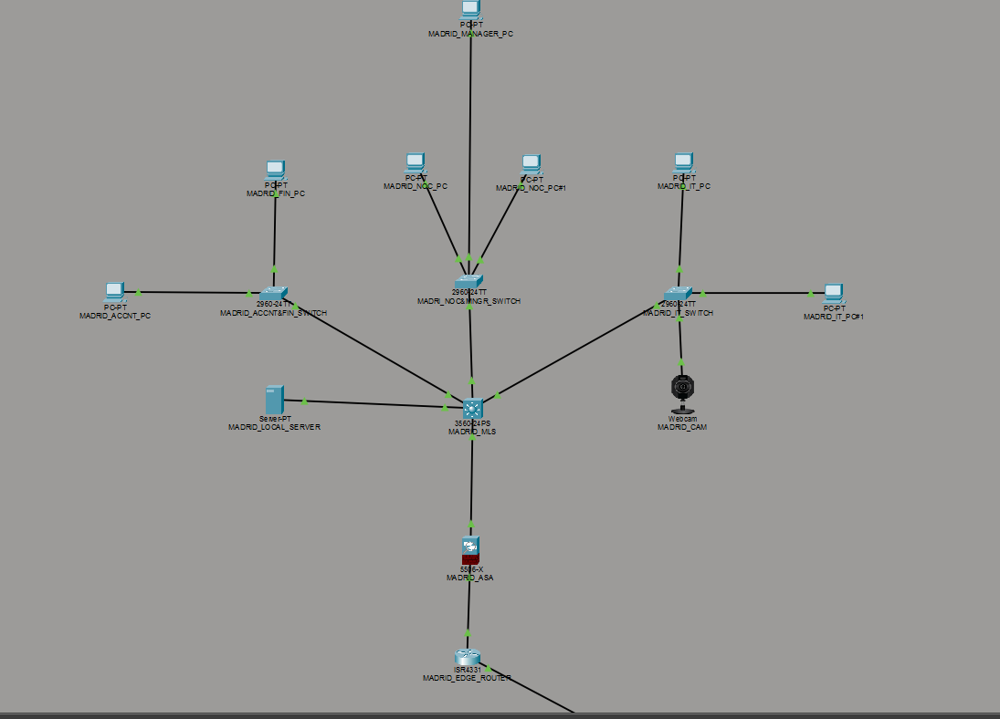
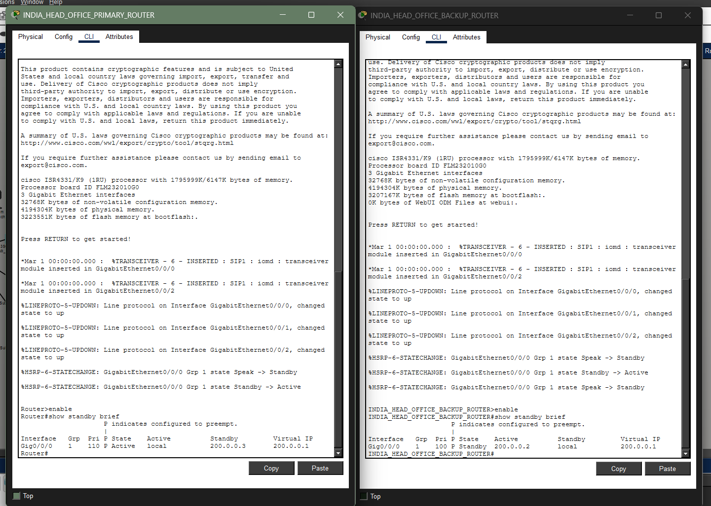
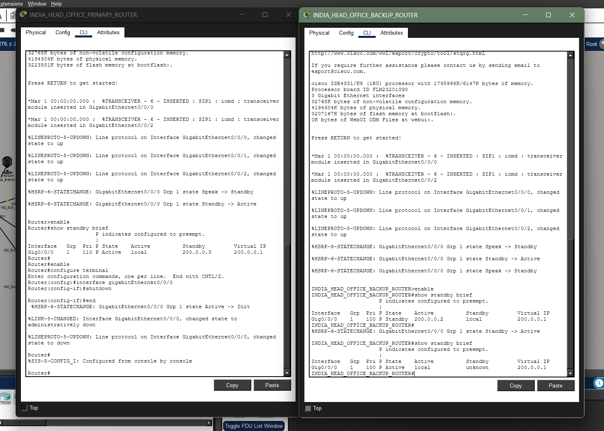
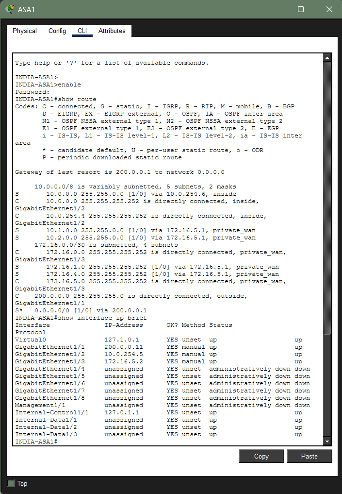
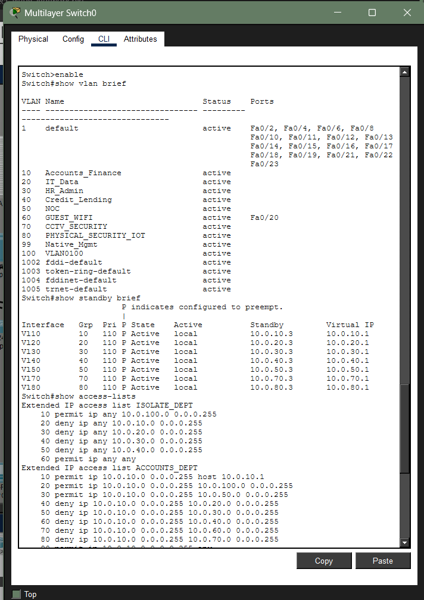
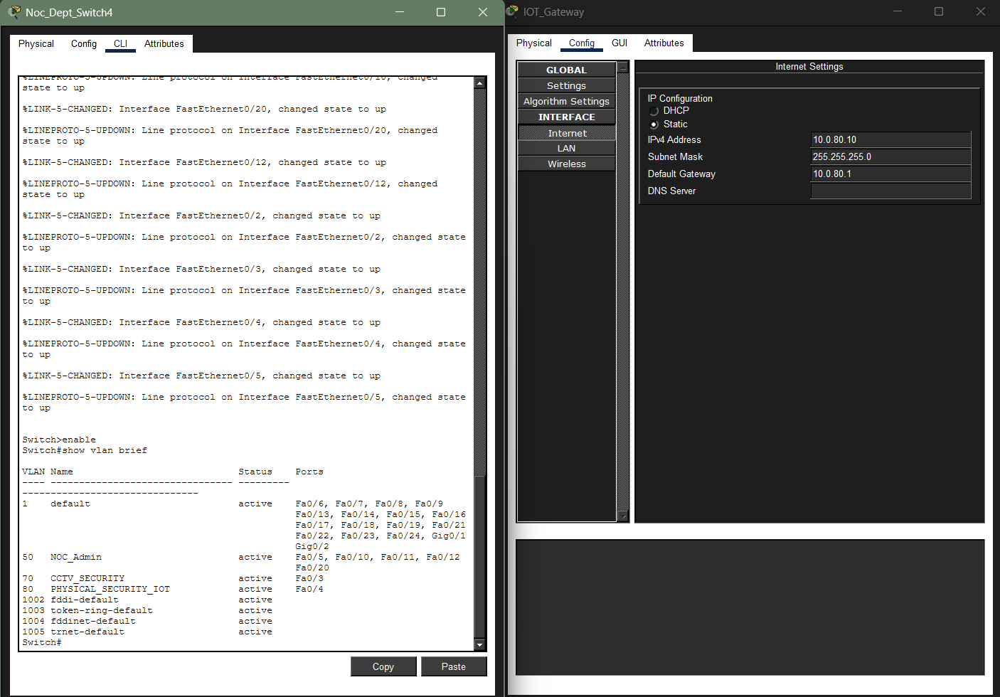
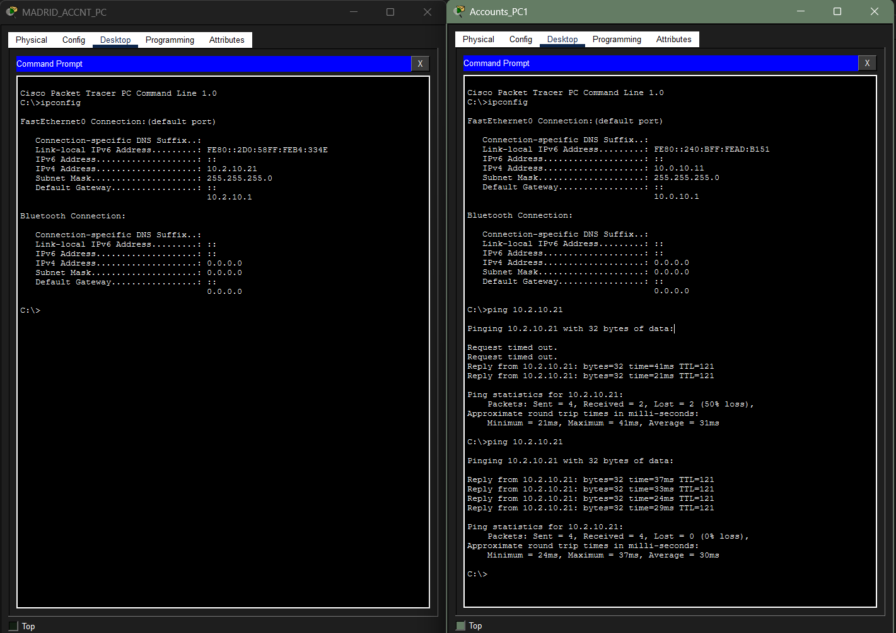

# IntaFin Enterprise Banking Network

**Enterprise-grade multi-site banking network simulation built with Cisco Packet Tracer 9.0.**

This project models a banking network connecting the India Head Office, Indian branch offices and Madrid office. It demonstrates VLAN segmentation, multilayer switching, HSRP, ASA firewall policies, routed WAN connectivity, department-level access controls, CCTV and IoT physical-security components.

> **Implementation note:** The Packet Tracer file is the source of truth for the saved configuration. This repository distinguishes implemented and tested features from design goals or partially validated enhancements. It is a learning simulation, not a production banking network.

## Repository map

| Folder | Purpose |
|---|---|
| Packet-Tracer/ | Main Cisco Packet Tracer simulation |
| Screenshots/ | Topology, site layouts, HSRP, ASA, VLAN/ACL, CCTV/IoT and inter-site evidence |
| Documentation/ | Formal report and project documentation |
| Network-Design/ | Topology overview, site design, VLAN and IP addressing plan |
| Configurations/ | CLI command references and configuration notes |
| Security-Architecture/ | Firewall boundaries, ACL segmentation and physical-security design |
| Testing-Validation/ | Verification procedures, test scenarios and limitations |

## Sites and components

- India Head Office: multilayer switching, department VLANs, HSRP, ASA firewall, server farm, NOC, CCTV and IoT segment.
- India Sub-Branch 1: branch router, ASA firewall, multilayer switch, access switch and department networks.
- India Sub-Branch 2: included in the wider project design; verify the saved simulation before assuming every service is configured.
- Madrid Office, Spain: edge router, ASA firewall, multilayer switch, local DHCP/server segment and department VLANs.
- WAN aggregation: routed aggregation switch connecting the ISP, India sites and Madrid edge.

## Key technologies

Cisco Packet Tracer 9.0; VLANs and 802.1Q trunks; Layer-3 switching; inter-VLAN routing; HSRP; Cisco ASA firewall interfaces; static routing; NAT/PAT; ACLs; DHCP and helper addressing; CCTV and IoT segmentation.

## Logical topology

    ISP / Internet
          |
    WAN_AGGREGATION_MLS
       /      |       \
      /       |        \
 India HO  Branch 1  Madrid Edge
     |                 |
  ASA / MLS          ASA / MLS
     |                 |
 Dept VLANs         Dept VLANs
 Servers, NOC       Local Server
 CCTV and IoT       CCTV

This is a high-level logical view, not a physical cabling diagram.

## India Head Office VLAN reference

| VLAN | Purpose | Subnet |
|---:|---|---|
| 10 | Accounts | 10.0.10.0/24 |
| 20 | Customer Service | 10.0.20.0/24 |
| 30 | Management | 10.0.30.0/24 |
| 40 | IT | 10.0.40.0/24 |
| 50 | NOC / Administration | 10.0.50.0/24 |
| 60 | Server-related | 10.0.60.0/24 |
| 70 | CCTV Security | 10.0.70.0/24 |
| 80 | Physical Security / IoT | 10.0.80.0/24 |
| 99 | Network Management | 10.0.99.0/24 |
| 100 | Server Farm | 10.0.100.0/24 |

## Madrid VLAN reference

| VLAN | Purpose | Subnet |
|---:|---|---|
| 10 | Accounts / Finance | 10.2.10.0/24 |
| 20 | Manager / Administration | 10.2.20.0/24 |
| 30 | NOC | 10.2.30.0/24 |
| 40 | IT | 10.2.40.0/24 |
| 50 | CCTV Security | 10.2.50.0/24 |
| 99 | Management | 10.2.99.0/24 |
| 100 | Server Farm | 10.2.100.0/24 |

## Verification notes and known limitations

- Employee VLAN communication between India and Madrid was tested in the documented scenarios.
- Selected server and CCTV destinations were intentionally restricted in the documented tests.
- HSRP state and a failover transition are documented for the India Head Office edge-router pair.
- Newly supplied evidence shows the India Head Office primary and backup ISR4331 routers with HSRP VIP 200.0.0.1, and a captured transition in which the backup router becomes Active after the primary interface is shut down. A separate ASA1 screenshot shows its private-WAN interface at 172.16.5.2/30 and static routes using 172.16.5.1 as next hop. This is evidence that the backup-side private-WAN interface and routes are configured. Full end-to-end application and firewall-path failover should still be tested before claiming complete site-level high availability.
- IoT endpoints and RFID readers were addressed in the physical-security design. Do not claim automated door, smoke-alarm or HVAC response unless the automation is configured and demonstrated.
- Packet Tracer ASA diagnostic support is limited compared with real ASA software.

## Open the simulation

1. Install Cisco Packet Tracer 9.x.
2. Open Packet-Tracer/IntaFin_Cisco_project_WAN_Network.pkt.
3. Inspect the topology and device configurations.
4. Follow the Testing-Validation folder for verification procedures.

## Author

**Shanmuga Sundhar S**  
BigLearn Training Institute, Tiruchirappalli  
Computer Networking

## Visual project evidence

The following images are original Packet Tracer screenshots stored in the repository.

### Multi-site topology

### Site layouts
| India Head Office | Branch Office |
|---|---|
|  |  |

### High availability and security evidence
| HSRP active / standby | HSRP failover |
|---|---|
|  |  |

Browse the [complete screenshot gallery](Screenshots/README.md) and [evidence register](Screenshots/Evidence-Register.md).

## License

MIT License. See LICENSE.
