# Screenshots and Project Evidence

**11 original Packet Tracer screenshots uploaded and verified.**

Open any image to view it at full resolution. The previews below are embedded directly from this folder.

## 01 — Full Network Topology
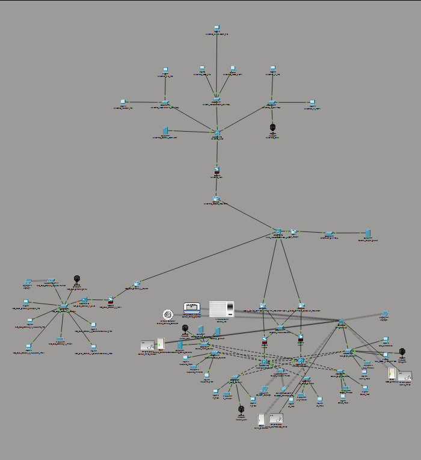

## 02 — India Head Office
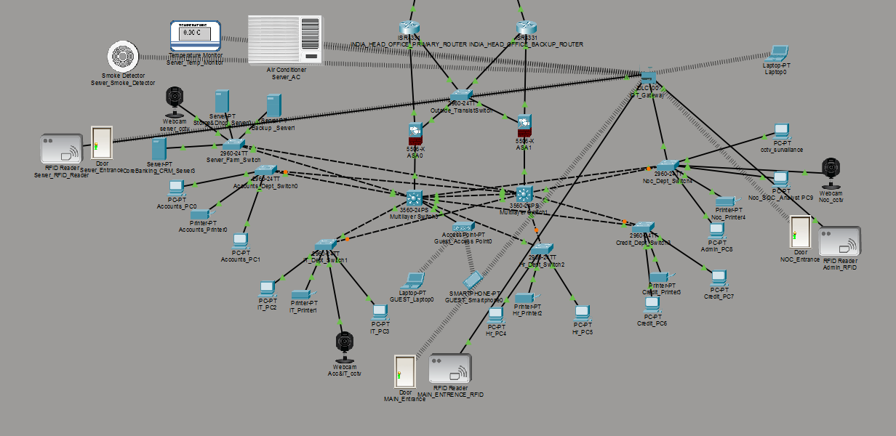

## 03 — Branch Office
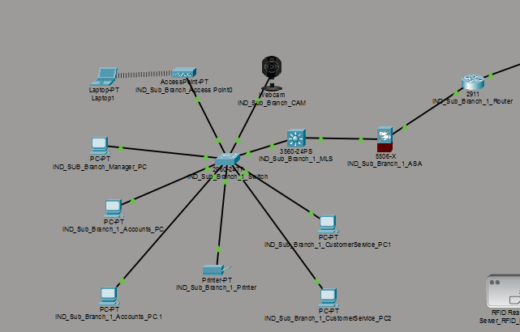

## 04 — Madrid Office
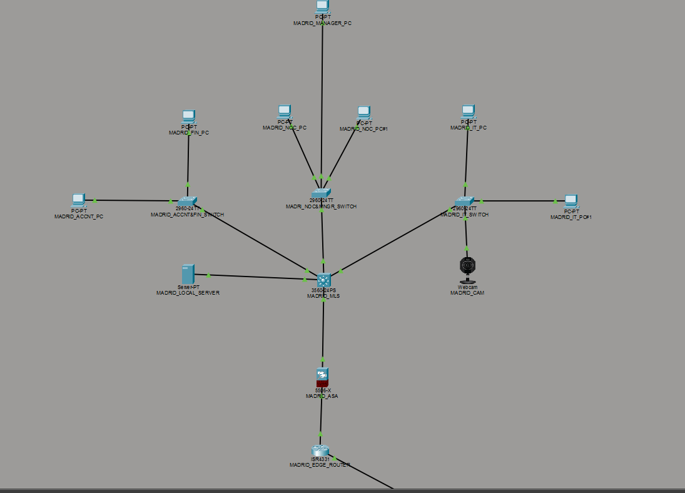

## 05 — HSRP Active / Standby
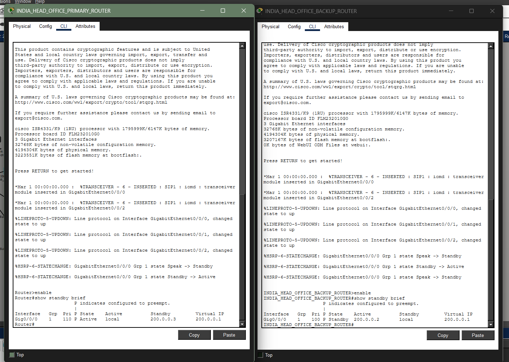

## 06 — HSRP Failover
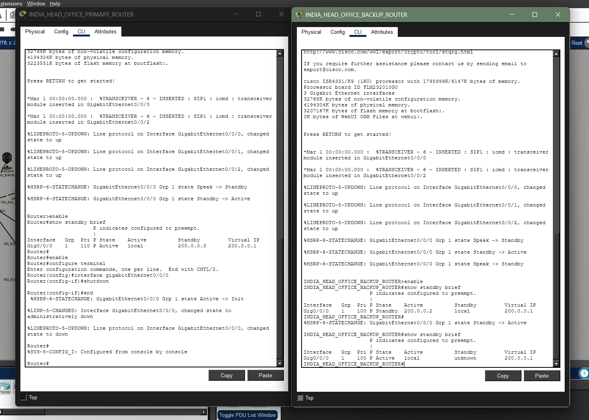

## 07 — ASA Firewall Routes
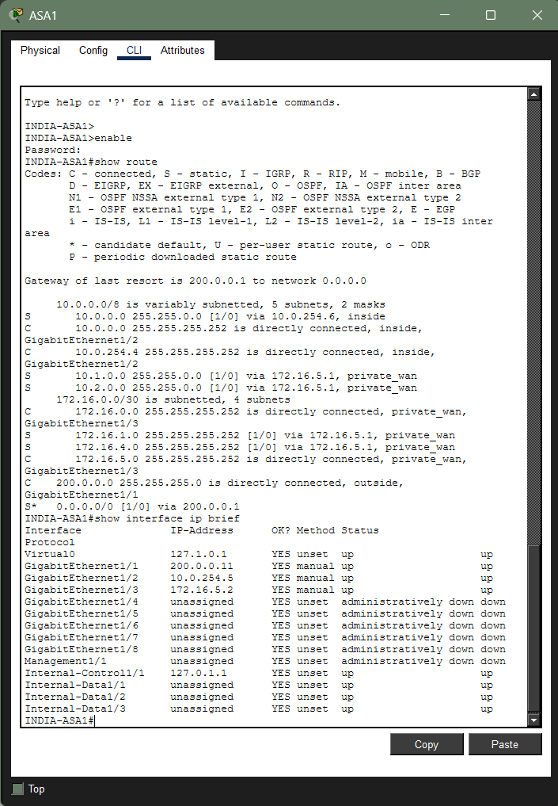

## 08.1 — VLAN and ACL Verification
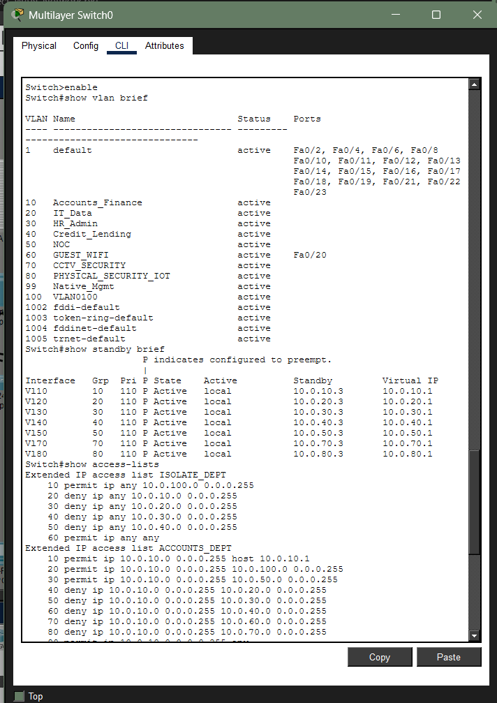

## 08.2 — VLAN and ACL Verification
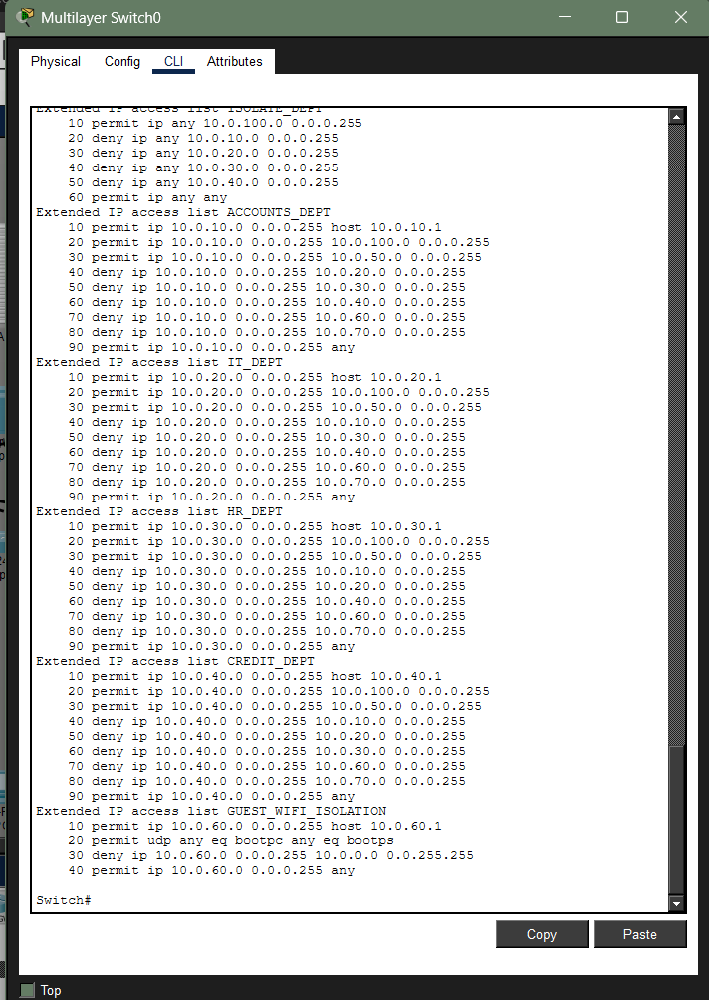

## 09 — CCTV and IoT Security
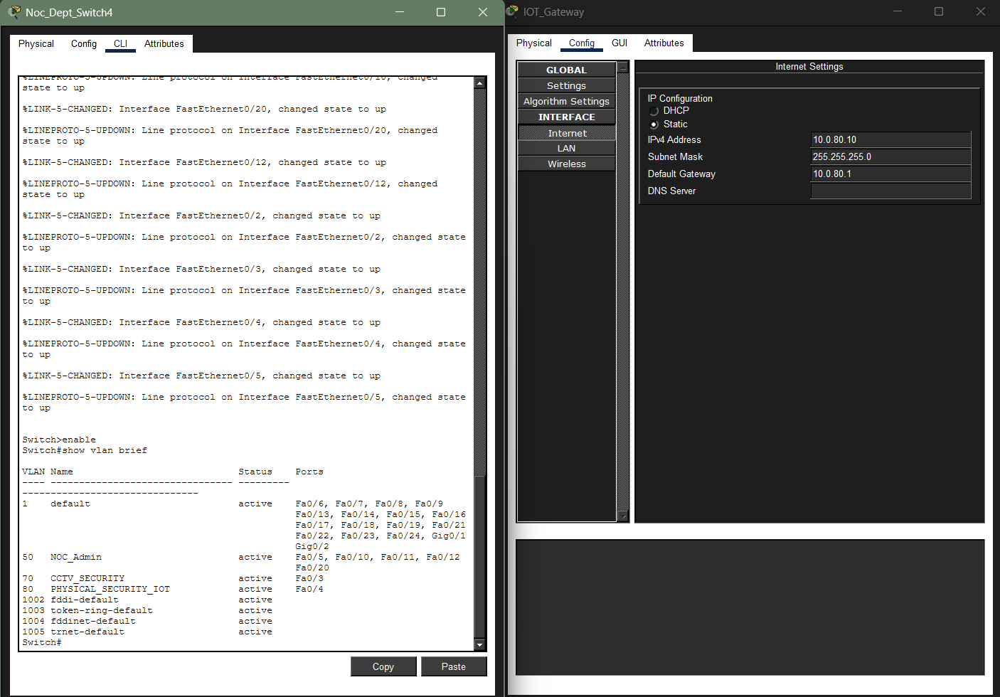

## 10 — Inter-Country Access Test
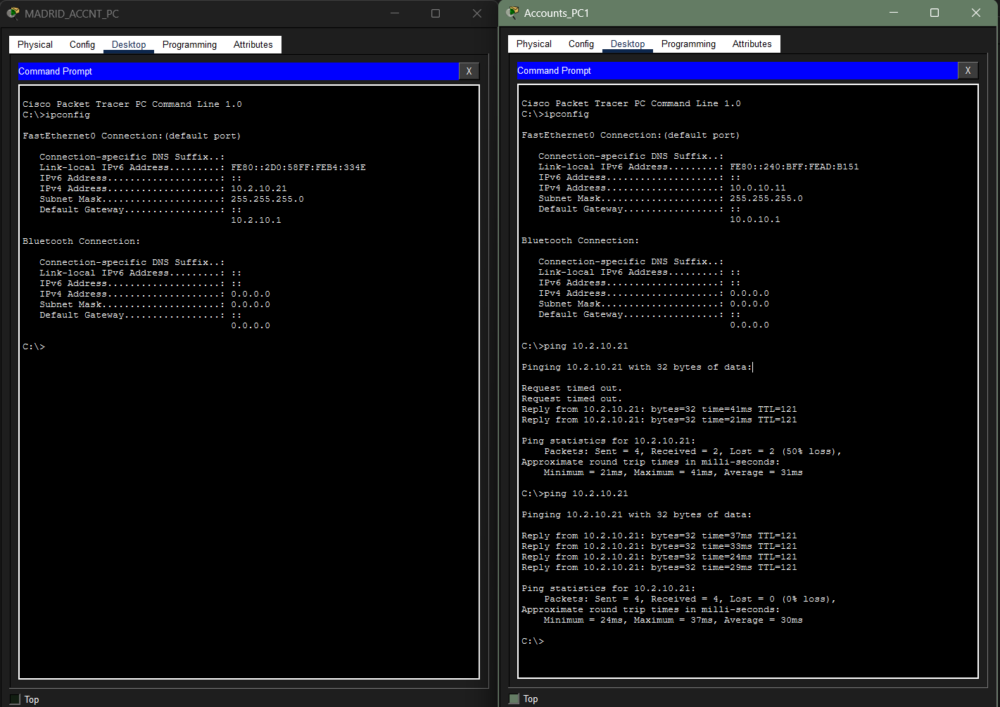

See [Evidence-Register.md](./Evidence-Register.md) for the file index and purpose of each screenshot. Images are stored as original PNG evidence.
